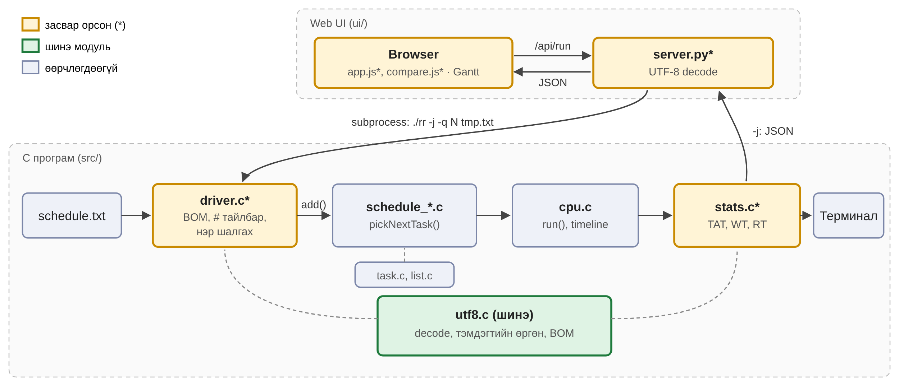
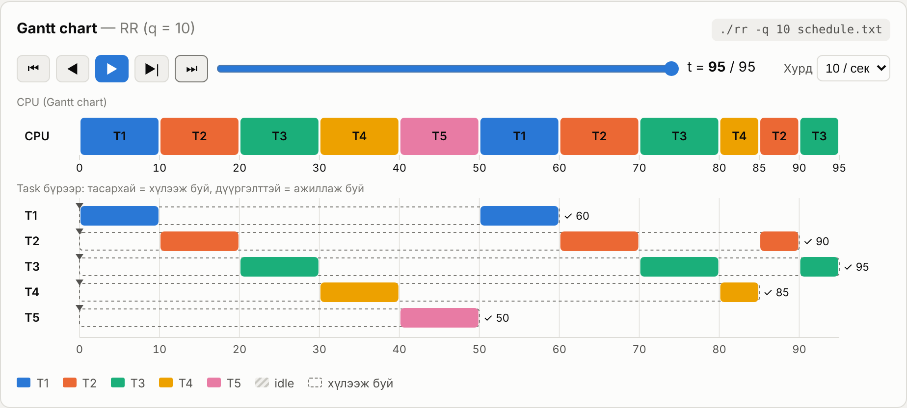
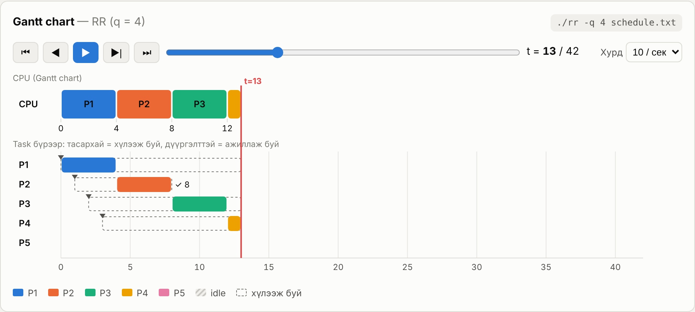
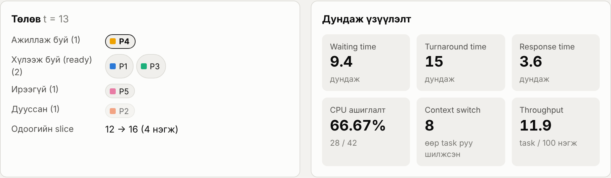
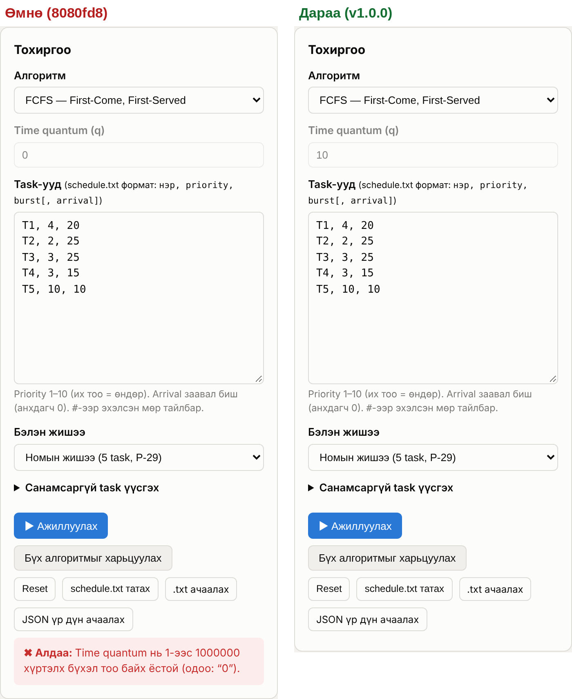
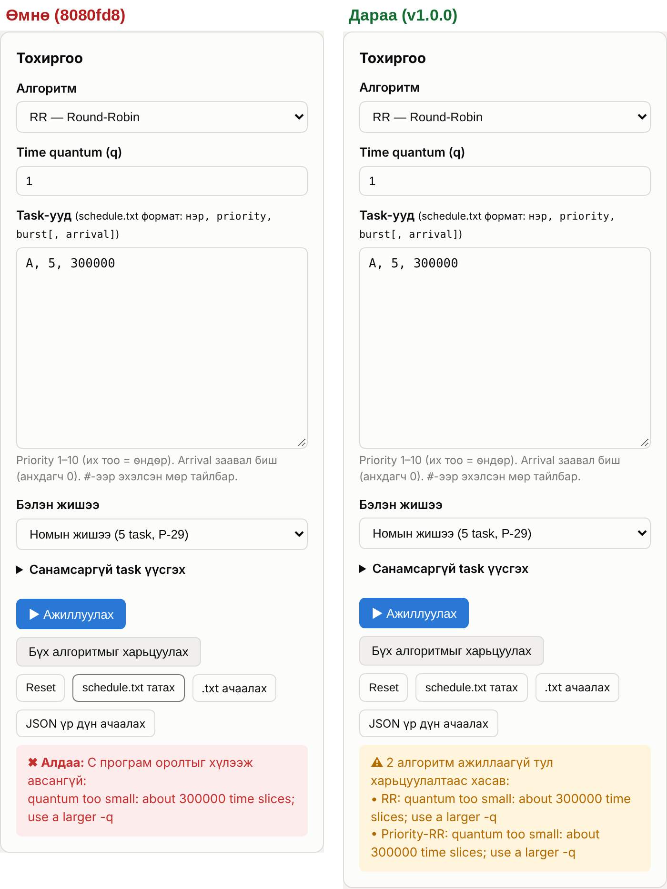
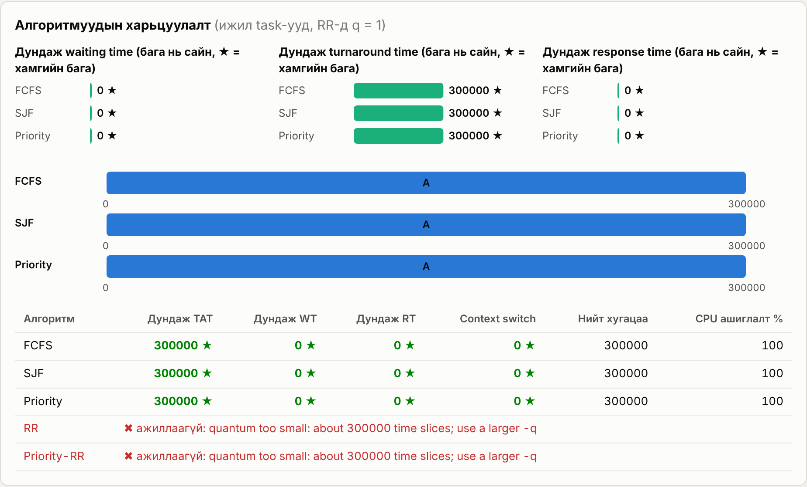
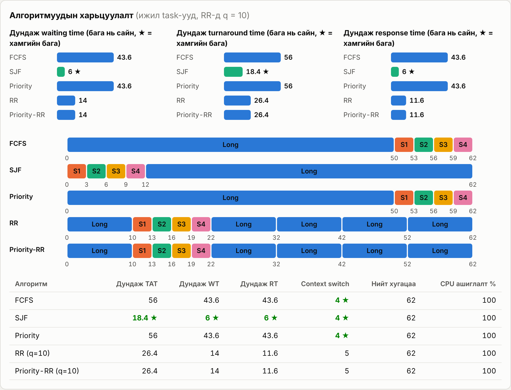
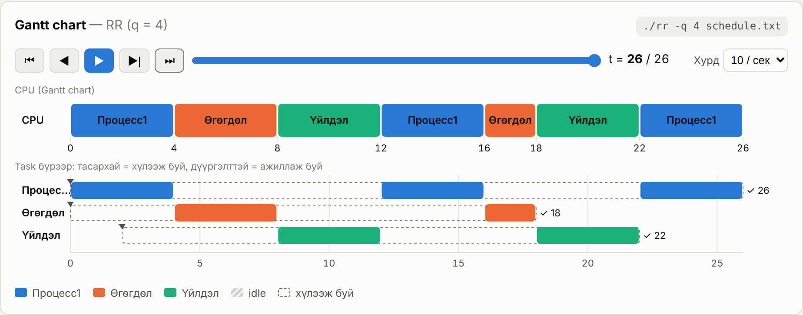

# БИЕ ДААЛТ 2 — ЭЦСИЙН ТАЙЛАН (Final Report)

**ШИНЖЛЭХ УХААН ТЕХНОЛОГИЙН ИХ СУРГУУЛЬ** · Мэдээлэл, холбооны технологийн сургууль
Үйлдлийн систем (F.CSM302) · 2026-2027 оны хичээлийн жилийн намар

| Талбар | Мэдээлэл |
|---|---|
| **Төсөл** | CPU Scheduling — Scheduling Algorithms, UI: Gantt chart |
| **Хуваарилалтын код** | II-4-8 |
| **Хувилбар** | v1.0.0 |
| **Хичээл заасан багш** | Г.Ганбат /F.CS10/ |
| **Гүйцэтгэсэн** | B241940003 (Д.Хосбаяр), B241940141 (Н.Төрболд), B222270023 (М.Алтан-Од), B242270072 (Д.Анхбаяр) |

PDF хувилбар: [II-4-8_Final_Report.pdf](II-4-8_Final_Report.pdf)

## Хураангуй

Энэ тайлан нь БД1-ээр хийсэн CPU Scheduling төслийн эцсийн хувилбар **v1.0.0**-ийг тайлагнана. Төсөл нь *Operating System Concepts* (10th ed.) номын 5-р бүлгийн "Scheduling Algorithms" programming project-ын таван алгоритмыг (FCFS, SJF, Priority, RR, Priority-RR) C11 хэлээр хэрэгжүүлж, үр дүнг interactive Gantt chart-аар дүрсэлдэг [1].

IV-2-15 багийн албан ёсны шүүмж 5 асуудал илрүүлсэн. Бүгд Minor түвшнийх бөгөөд Critical, Major асуудал гараагүй. Мөн 2 ажиглалт өгсөн. Шүүмж бүрийг давтан баталгаажуулж, **5 асуудлыг бүгдийг засав**. Хоёр ажиглалтын нэгийг бүрэн, нэгийг хэсэгчлэн хүлээн авав.

Гол сайжруулалт:

- **Оролтын файл (A1, A2, A5).** UTF-8 BOM-той файл, кирилл үсэгтэй task-ын нэр, мөрийн төгсгөлийн `#` тайлбарыг уншдаг болсон. Үүний тулд UTF-8 задлах тусдаа `utf8.c` модуль нэмэв.
- **Харьцуулалт (A3).** Нэг алгоритм ажиллахгүй үед бусад алгоритмын үр дүн харагдаж, алдаа алгоритм тус бүрээр мэдээлэгддэг болсон.
- **Quantum талбар (A4).** Идэвхгүй quantum талбарт үлдсэн буруу утга FCFS, SJF, Priority-г хориглохоо больсон.

Засвар бүрт автомат тест нэмсэн тул тестийн тоо **73-аас 91** болж, бүгд тэнцэв. Хуучин кодыг шинэ тестээр шалгахад 16 тест унаж, шинэ кодоор 0 болсон нь засвар үр дүнтэйг харуулна. Өмнөх 49 golden файл өөрчлөгдөөгүй, reference шалгалт 1500/1500, ASan/UBSan 185 гүйлтэд 0 мэдээлэл, GCC ба Clang 0 анхааруулга гарсан тул regression илрээгүй.

| Талбар | Утга |
|---|---|
| Хуваарилалтын код | II-4-8 |
| Repository | https://github.com/Ankhbayr33/F.CSM302-2-4-8 |
| Final release | tag `v1.0.0` |
| БД1 хувилбар (шүүмжлүүлсэн) | commit `8080fd8` |
| Шүүмжийн засварын commit | `10351a2` |
| Шүүмж | IV-2-15, 2026-11-08 |

## 1. Төслийн тойм

### 1.1. Номын шаардлага

Номын project нь `schedule.txt` файлаас `[name], [priority], [burst]` мөрүүдийг уншиж, сонгосон алгоритмаар нэг CPU дээр хуваарилах програм бичихийг шаарддаг. Priority нь 1–10, их тоо нь өндөр, RR-ийн quantum 10 байна. Эх кодын бүтэц нь `driver.c` (файл унших), `schedule_*.c` (`add()`, `schedule()`, `pickNextTask()`), `cpu.c` (`run()`) бөгөөд `make fcfs` маягаар build хийнэ [1].

| Шаардлага | Хэрэгжилт |
|---|---|
| FCFS, SJF, Priority, RR, Priority-RR | `src/schedule_*.c`, тус бүр тусдаа executable |
| RR quantum = 10 | `QUANTUM 10`, `-q N`-ээр өөрчилнө |
| Priority 1–10, их нь өндөр | Хүрээнээс гарвал алдаа |
| Номын эх кодын бүтэц | `driver.c`, `list.c`, `cpu.c`, `task.c`, `schedule_*.c` |
| Further Challenge 1: atomic tid | `__sync_fetch_and_add` (`task.c`) |
| Further Challenge 2: дундаж TAT, WT, RT | `stats.c` |
| Нэмэлт: arrival time | 4 дэх талбар, заавал биш (анхдагч 0) |
| UI: Gantt chart | `ui/` — Python stdlib сервер ба JavaScript |

### 1.2. БД1-ээс БД2 хүртэл

БД1-ийн хувилбарт таван алгоритм, JSON гаралт, Gantt chart UI (тоглуулагч, агшин дахь төлөв, харьцуулалт), 73 автомат тест багтсан. БД2-т шинэ функц нэмэлгүй, шүүмжийн дагуу оролтын найдвартай байдал, UI-ийн зан төлөв, баримт бичгийн нийцлийг сайжруулахад төвлөрөв.

| Огноо | Үйл явдал | Хувилбар |
|---|---|---|
| БД1 | Тайлан, Manual, repository нийтэлсэн | `8080fd8` |
| 2026-11-08 | IV-2-15 багийн шүүмж ирсэн (A1–A5, 2 ажиглалт) | — |
| БД2 | A1–A5 засвар, тест 73 → 91 | `10351a2` |
| БД2 | Manual, README, Final Report, Poster шинэчилсэн | tag `v1.0.0` |

## 2. Эцсийн архитектур

Архитектурын үндсэн бүтэц өөрчлөгдөөгүй. C програм файлыг уншиж, хуваарилж, үр дүнг текст эсвэл JSON-оор гаргана. Python сервер C програмыг subprocess болгон ажиллуулж, JSON-ыг browser руу дамжуулна. Шар хүрээтэй компонент засвар орсон, ногоон нь шинээр нэмэгдсэн компонент (Зураг 1).

 <em>Зураг 1. Эцсийн архитектур. * тэмдэгтэй, шар нь засвар орсон, ногоон нь шинэ компонент</em>

| Компонент | Өөрчлөлт | Шалтгаан |
|---|---|---|
| `src/utf8.c`, `utf8.h` (шинэ, 75 мөр) | UTF-8 тэмдэгт задлах, тэмдэгтээр урт тоолох, BOM илрүүлэх | A1, A2 |
| `src/driver.c` | BOM алгасах, `#`-ээс хойшхийг тайлбар гэж үзэх, кирилл нэр зөвшөөрөх, тодорхой алдааны мессеж | A1, A2, A5 |
| `src/task.h`, `task.c` | Нэрийн буфер 31 тэмдэгт × 4 байт | A2 |
| `src/stats.c` | Gantt ба хүснэгтийг тэмдэгтийн тоогоор зэрэгцүүлэх | A2 |
| `ui/server.py` | C-ийн гаралтыг locale-оос үл хамааран UTF-8-аар унших | A2 |
| `ui/app.js` | Quantum-ыг зөвхөн RR төрөлд шалгах; харьцуулалтад амжилттай болон алдаатай үр дүнг салгах | A3, A4 |
| `ui/compare.js`, `style.css` | "✖ ажиллаагүй" мөр, богино "★" шошго | A3 |
| `Makefile` | `utf8` модулийг нийтлэг файлд нэмсэн | A1, A2 |
| `tests/` | 2 data файл, 3 алдааны файл, 14 expected файл, `ui_test.js` | Бүгд |

Код дахь өөрчлөлт нийт 13 файлд 309 мөр нэмэгдэж, 37 мөр устсан (тестийн expected файлыг тооцохгүй). Хуваарилах алгоритмын файлууд (`schedule_*.c`) болон `cpu.c`-д өөрчлөлт ороогүй тул тооцооллын логик БД1-тэй яг ижил.

## 3. Туршилт ба дүрслэл

### 3.1. Туршилтын орчин

| Үзүүлэлт | Манай орчин | Шүүмжлэгчийн орчин |
|---|---|---|
| OS | Ubuntu 24.04 LTS (x86-64); Windows + WSL Ubuntu | Ubuntu 24.04.5 LTS |
| Compiler | GCC 13.3, Clang 18 (`-std=c11 -Wall -Wextra -pedantic`) | GCC 13.3.0 |
| Build | GNU Make 4.3 | GNU Make 4.3 |
| Python | 3.13 ба 3.12.3 | 3.12.3 |
| Browser | Chromium (Playwright), Brave | Brave |
| UI тест | Node.js 22, Playwright | — |

### 3.2. Тестийн бүтэц

`make test` нь таван хэсэгтэй (Хүснэгт 1). Golden тест нь програмын гаралтыг хадгалсан expected файлтай байт бүрээр тулгана. Reference тест нь C кодоос үл хамаарах Python хэрэгжүүлэлтээр 300 санамсаргүй багцыг 5 алгоритмаар шалгана. UI тест нь Playwright-аар browser-ийг автоматаар удирдаж, шүүмжид заасан алхмыг давтана.

| Хэсэг | Тоо | Юуг шалгах |
|---|---|---|
| Golden | 63 | 9 data файл × 5 алгоритм (RR-д q = 10 ба 4) |
| Алдаатай оролт | 16 | Мөр бүрийн тодорхой алдааны мессеж |
| Сонголт ба JSON | 10 | `-q`, `-j`, `-h`, JSON бүтэц |
| Reference | 1 | 1500 тохиолдол (300 багц × 5 алгоритм) |
| UI | 1 | 11 шалгалт: A2, A3, A4 ба регресс |
| **Нийт** | **91** | |

*Хүснэгт 1. Автомат тестийн бүтэц*

### 3.3. Ажиглалтын урсгал

UI дээр хэрэглэгч дараах урсгалаар туршилт хийнэ:

1. **Өгөгдөл сонгох.** Бэлэн жишээ (номын жишээ, arrival, convoy, кирилл нэр гэх мэт), санамсаргүй үүсгэгч эсвэл `.txt` файл ачаална.
2. **Алгоритм ба quantum сонгох.** Quantum талбар зөвхөн RR, Priority-RR үед идэвхтэй.
3. **Ажиллуулах.** C програмын бодит гаралтаар Gantt chart, хүснэгт, дундаж үзүүлэлт гарна.
4. **Тоглуулах.** Play, step, reset-ээр цагийг алхам алхмаар урагшлуулж, тухайн агшин дахь running, ready, waiting, finished төлөвийг харна.
5. **Харьцуулах.** "Бүх алгоритмыг харьцуулах" нь 5 алгоритмын мини Gantt, bar chart, хүснэгтийг зэрэгцүүлнэ.

 <em>Зураг 2. Номын жишээ, RR (q = 10). Context switch 10, дундаж RT 20</em>

 <em>Зураг 3. Arrival-тай жишээ, RR (q = 4), t = 13 агшинд зогсоосон. 26–40 хооронд CPU idle</em>

 <em>Зураг 4. t = 13 агшин дахь task бүрийн төлөв</em>

## 4. Reviewer Responses

IV-2-15 багийн шүүмжийн 7-р хэсгийн 5 асуудал (A1–A5) болон Build/Run хэсгийн 2 ажиглалтыг (O1, O2) нэгтгэв. Өөр баг, оюутнаас техникийн comment ирээгүй. Асуудал бүрийг шүүмжид бичсэн алхмаар давтаж, засварын өмнө тест бичиж унахыг нь баталгаажуулсны дараа засав. Дэлгэрэнгүй шалтгаан, засварыг `docs/REVIEW_RESPONSE.md`-д бичсэн.

| № | Шүүмж | Priority | Шийдвэр | Өөрчлөлт ба нотолгоо |
|---|---|---|---|---|
| A1 | UTF-8 BOM-той файлыг уншиж чадахгүй, `invalid task name 'T1'` алдаа гарна | Minor | Зөвшөөрсөн | Эхний мөрийн BOM-г алгасна (`driver.c`, `utf8_has_bom()`). Commit `10351a2`. Тест: `bom_comments.txt` × 7 golden |
| A2 | Кирилл нэр (`Процесс1`) татгалзагдаж, зөвшөөрөх хүрээ тодорхойгүй | Minor | Зөвшөөрсөн | Кирилл үсэг (U+0400–U+04FF, Ө Ү орно) зөвшөөрөгдөнө, 31 тэмдэгт; мессеж, Manual 1.4, 1.8 шинэчилсэн. Commit `10351a2`. Тест: `cyrillic.txt` × 7 golden, 3 алдааны тест, UI тест. Зураг 9 |
| A3 | Харьцуулалтад нэг алгоритмын алдаа бусад алгоритмын үр дүнг нууна | Minor | Зөвшөөрсөн | Амжилттай үр дүнг харьцуулж, алдааг алгоритм тус бүрээр харуулна (`app.js`, `compare.js`). Commit `10351a2`. Тест: `ui_test.js` (3 шалгалт). Зураг 6, 7 |
| A4 | Идэвхгүй quantum талбарт үлдсэн `0` FCFS-ийг ажиллуулахгүй | Minor | Зөвшөөрсөн | Шүүмжийн хоёр саналыг хоёуланг нь: quantum-ыг зөвхөн RR төрөлд шалгах, шилжихэд буруу утгыг 10 болгох (`app.js`). Commit `10351a2`. Тест: `ui_test.js` (4 шалгалт). Зураг 5 |
| A5 | README-ийн жишээ `T2, 2, 25, 5   # …` алдаа өгдөг | Minor | Зөвшөөрсөн | Шүүмж README-г засахыг санал болгосон. Бид parser-ийг өөрчилж `#`-ээс хойшхийг тайлбар болгосон тул README-ийн жишээ өөрчлөлтгүйгээр зөв болов. Нэрэнд `#` зөвшөөрөгддөггүй тул давхар утга үүсэхгүй. Commit `10351a2`. Тест: `bom_comments.txt`. Manual 1.4 |
| O1 | Brave browser Manual-ын жагсаалтад байхгүй боловч UI ажилласан | Suggestion | Зөвшөөрсөн | Manual 1.2-ын дэмжих орчин, README-ийн туршсан орчны хүснэгтэд Brave нэмсэн. Commit `2d8c29b` |
| O2 | `make ui` үед терминалд Brave-ийн `zygote … Broken pipe (32)` мөр гарна | Suggestion | Хэсэгчлэн | Мессеж нь browser процессоос гардаг, сервер HTTP-д нөлөөлөхгүйг шүүмжлэгч өөрөө тэмдэглэсэн. Сервер `webbrowser.open()`-оор browser-ийг нээдэг тул browser-ийн stderr-ийг манай кодоос хаах найдвартай арга байхгүй. Иймд кодыг өөрчлөөгүй. Manual 2.8 Known issues-д тайлбар болон `python3 ui/server.py --no-browser` хувилбарыг бичсэн. Commit `2d8c29b` |

*Хүснэгт 2. Reviewer Comments and Responses*

Зөвшөөрөөгүй санал байхгүй. Шүүмжийн дүгнэлтэд дурдсан гурван чиглэл (харьцуулалтын алдааны боловсруулалт, quantum шалгалт, оролт ба баримт бичгийн нийцэл) бүгд хэрэгжсэн.

## 5. Дахин туршилт

### 5.1. Засварын өмнө ба дараах тест

Засвар үнэхээр асуудлыг шийдсэн эсэхийг батлахын тулд шинэ тестийг хуучин кодоор (`8080fd8`) болон шинэ кодоор ажиллуулав (Хүснэгт 3).

| Код | Тест | Passed | Failed | Тайлбар |
|---|---|---|---|---|
| Хуучин `8080fd8` | Хуучин (73) | 73 | 0 | БД1-ийн төлөв |
| Хуучин `8080fd8` | Шинэ (91) | 75 | **16** | Шүүмжийн асуудлууд тестээр илэрсэн |
| Шинэ `v1.0.0` | Шинэ (91) | **91** | **0** | Бүх асуудал засагдсан |
| Шинэ `v1.0.0`, Playwright-гүй | Шинэ (91) | 90 | 0 | UI тест SKIP |

*Хүснэгт 3. Засварын өмнө ба дараах автомат тест*

Хуучин код дээр унасан 16 тест: `bom_comments.txt`-ийн 7 golden (A1, A5), `cyrillic.txt`-ийн 7 golden (A2), кирилл нэрийн уртын алдааны мессеж (A2), UI тест (A4-ийн шалгалт дээр зогссон). Шинэ код дээр бүгд тэнцсэн.

### 5.2. Шүүмжийн тохиолдлуудыг давтах

Шүүмжлэгчийн нэмэлт тест №12–17-г яг тэр оролтоор хуучин болон шинэ кодоор давтав.

| Тест | Засварын өмнө | Засварын дараа | Дүгнэлт |
|---|---|---|---|
| №12 BOM-той `T1, 4, 20` (A1) | `invalid task name 'T1'` | Ажиллана, avg WT 0.00 | Засагдсан |
| №13 `Процесс1, 4, 20` (A2) | `invalid task name 'Процесс1' (use letters, digits, _ - ., …)` | Ажиллана, Gantt-д `Процесс1` | Засагдсан |
| №13 хил: 31 / 32 кирилл тэмдэгт | — | 31 OK, 32 алдаа | Хүрээ тодорхой |
| №13 хил: буруу UTF-8, `任务`, emoji | — | Тодорхой мессежтэй алдаа | Хүрээ тодорхой |
| №14 Compare, `A, 5, 300000`, q = 1 (A3) | Зөвхөн `quantum too small` алдаа | 3 алгоритмын харьцуулалт, RR, Priority-RR "✖ ажиллаагүй" | Засагдсан |
| №15 RR, q = 4.5 | Алдаа | Алдаа (өөрчлөгдөөгүй) | Хэвээр зөв |
| №16 RR → q = 0 → FCFS (A4) | `Time quantum … (одоо: "0")`, FCFS ажиллахгүй | Талбар 10 болж, FCFS ажиллана | Засагдсан |
| №17 README-ийн жишээ (A5) | `line 2: expected 'name, priority, burst[, arrival]'` | Ажиллана, avg WT 7.50 | Засагдсан |

*Хүснэгт 4. Шүүмжийн тохиолдлуудын өмнө ба дараах үр дүн*

 <em>Зураг 5. A4: RR-д q = 0 оруулаад FCFS руу шилжиж "Ажиллуулах" дарсан. Өмнө нь алдаа гарч байсан, одоо талбар 10 болж FCFS ажиллана</em>

 <em>Зураг 6. A3: q = 1, burst 300000-аар "Бүх алгоритмыг харьцуулах". Өмнө нь ганц алдаа, одоо ажиллаагүй 2 алгоритмын анхааруулга</em>

 <em>Зураг 7. A3-ийн засварын дараах харьцуулалт: FCFS, SJF, Priority харагдаж, RR ба Priority-RR "✖ ажиллаагүй" мөрөнд гарна</em>

### 5.3. Regression

Засвар өмнө зөв ажиллаж байсан зүйлийг эвдээгүйг дараах байдлаар шалгав.

| Шалгалт | Үр дүн |
|---|---|
| БД1-ийн 49 golden файл | Өөрчлөгдөөгүй, бүгд тэнцсэн |
| Reference (300 багц × 5 алгоритм) | 1500/1500 |
| Шүүмжлэгчийн үндсэн 10 тест | Бүгд ижил үр дүн (жишээ нь RR q = 1…30-ийн cs 94, 48, 18, 10, 6, 4, 4; номын жишээ RR q = 4: TAT 79.40, WT 60.40, RT 8.00, cs 25) |
| Шүүмжлэгчийн нэмэлт тест №1–8 | Бүгд ижил (Priority+arrival TAT 7.33 / WT 3.67; SJF тэнцэл Z, X, Y; 1000 task, avg WT 499 500 000; 1001 дэх task `too many tasks`) |
| ASan + UBSan, 5 алгоритм × 37 файл | 185 гүйлт, 0 мэдээлэл |
| GCC 13.3, Clang 18 (`-Wall -Wextra -pedantic`) | 0 анхааруулга |
| UI регресс (`ui_test.js`) | Ердийн харьцуулалт 5 алгоритм, буруу оролтод ганц алдаа, JavaScript алдаа 0 |

*Хүснэгт 5. Regression шалгалт*

## 6. Эцсийн үр дүн

### 6.1. Номын жишээ

Номын жишээ (`T1, 4, 20 · T2, 2, 25 · T3, 3, 25 · T4, 3, 15 · T5, 10, 10`, бүгд 0-д ирнэ, RR q = 10) дээрх эцсийн үр дүн БД1-тэй яг ижил байна (Хүснэгт 6).

| Алгоритм | Avg TAT | Avg WT | Avg RT | Context switch |
|---|---|---|---|---|
| FCFS | 63.00 | 44.00 | 44.00 | 4 |
| SJF | **49.00** | **30.00** | 30.00 | 4 |
| Priority | 52.00 | 33.00 | 33.00 | 4 |
| RR | 76.00 | 57.00 | **20.00** | 10 |
| Priority-RR | 54.00 | 35.00 | 30.00 | 7 |

*Хүснэгт 6. Номын жишээний үр дүн (`./<алгоритм> schedule.txt`)*

SJF хамгийн бага дундаж WT өгсөн нь онолтой нийцнэ. RR-ийн WT хамгийн их боловч RT хамгийн бага, учир нь task бүр эхний 50 нэгжид CPU авна. Үүний төлөөсөнд context switch 4-өөс 10 болж өссөн.

### 6.2. Convoy effect ба arrival

Convoy жишээнд урт task эхэнд байгаа үед FCFS-ийн дундаж WT 43.6 байхад SJF 6.0, RR 14.0 болж буурав (Зураг 8). Arrival-тай жишээнд (RR, q = 4) 26–40 хооронд CPU idle болж, utilization 66.7%, дундаж WT 9.4, RT 3.6, context switch 8 гарсан (Зураг 3).

 <em>Зураг 8. Convoy жишээний 5 алгоритмын харьцуулалт</em>

### 6.3. Шинэ боломж: кирилл нэр

A2-ийн засвараар Монгол нэртэй task-ыг терминал, JSON, UI-д зөв харуулдаг болсон (Зураг 9).

 <em>Зураг 9. Кирилл нэртэй task-ууд (`tests/data/cyrillic.txt`), FCFS</em>

## 7. Хязгаарлалт

**Загварын хязгаарлалт.** Програм нь нэг CPU, бүхэл тоон simulated цаг ашиглана. Context switch-ийн зардал, I/O burst, олон CPU, preemptive SJF (SRTF), aging хэрэгжээгүй. Эдгээр нь номын project-ын хамрах хүрээнээс гадуур.

**Үлдсэн асуудал.**

- **Терминалын хүснэгт.** 8 тэмдэгтээс урт нэртэй task байвал терминалын хүснэгтийн багана шилждэг. JSON ба UI-д нөлөөлөхгүй.
- **Brave-ийн мессеж (O2).** `make ui` үед Brave-ийн `zygote … Broken pipe` мөр гарч болно. Серверийн ажиллагаанд нөлөөлөхгүй; `--no-browser` сонголтоор зайлсхийж болно.
- **Нэрийн тэмдэгт.** Зөвхөн латин ба кирилл үсэг зөвшөөрөгдөнө. Бусад бичиг (хятад, араб гэх мэт) болон emoji-г тодорхой мессежтэйгээр татгалзана.
- **Хэмжээ.** Хамгийн ихдээ 1000 task, RR-д 200 000 хүртэл slice. Үүнээс их бол `quantum too small` алдаа гарна.

**Дэмжих орчин.** Linux (Ubuntu 24.04 дээр туршсан), Windows дээр WSL. macOS-д GCC эсвэл Clang, `make`, Python 3.8+ байвал ажиллах ёстой боловч бид туршаагүй. UI-г Chromium (Playwright) болон Brave дээр туршсан. Бусад орчин үеийн browser-т ажиллах ёстой боловч автоматаар шалгаагүй. UI тест нь заавал биш бөгөөд Node.js 18+ ба Playwright шаардлагатай.

## 8. Дүгнэлт

Эцсийн хувилбар v1.0.0 нь номын таван алгоритмыг зөв тооцоолж, үр дүнг Gantt chart-аар ойлгомжтой дүрсэлнэ. Шүүмжийн 5 асуудлыг бүгдийг засаж, засвар бүрийг автомат тестээр баталгаажуулав. Тооцооллын логикт өөрчлөлт ороогүй бөгөөд regression илрээгүй.

Шүүмжээс суралцсан гол зүйлс:

- **Бодит хэрэглээний оролт.** Бид тестийг өөрсдийн бичсэн цэвэр ASCII файлаар хийж байсан. Windows Notepad-ийн BOM, Монгол нэр зэрэг бодит хэрэглэгчийн оролтыг шүүмжлэгч илрүүлсэн.
- **Баримт бичиг ба код нийцэх.** README-ийн жишээг програмаар ажиллуулж шалгаагүй байсан. Одоо Manual-ын жишээг тестэд оруулсан.
- **UI-ийн төлөв.** Идэвхгүй талбарын утга ч үйлдэлд нөлөөлж болно. UI-г гараар биш автомат тестээр шалгах нь давтагдах алдаанаас сэргийлнэ.
- **Нотолгоотой засвар.** Засварын өмнө тест бичиж хуучин код дээр унахыг харах нь засвар зөв асуудлыг шийдсэнийг баталдаг.

IV-2-15 багт нарийн, давтах боломжтой шүүмж өгсөнд баярлалаа.

## Хавсралт A. Сайжруулалтын бүртгэл

| № | Шүүмж | Priority | Шийдвэр | Хийсэн өөрчлөлт | Нотолгоо |
|---|---|---|---|---|---|
| 1 | A1 UTF-8 BOM | Minor | Зөвшөөрсөн | `driver.c`: эхний мөрийн BOM алгасах; `utf8.c` | `10351a2`; 7 golden; Хүснэгт 4 |
| 2 | A2 Кирилл нэр | Minor | Зөвшөөрсөн | `driver.c`, `task.h`, `stats.c`, `server.py`; Manual 1.4, 1.8 | `10351a2`; 7 golden, 3 алдааны тест, UI тест; Зураг 9 |
| 3 | A3 Харьцуулалт | Minor | Зөвшөөрсөн | `app.js`, `compare.js`, `style.css` | `10351a2`; `ui_test.js`; Зураг 6, 7 |
| 4 | A4 Quantum талбар | Minor | Зөвшөөрсөн | `app.js`: зөвхөн RR төрөлд шалгах, 10 болгох | `10351a2`; `ui_test.js`; Зураг 5 |
| 5 | A5 README жишээ | Minor | Зөвшөөрсөн | `driver.c`: мөрийн төгсгөлийн `#` тайлбар; Manual 1.4 | `10351a2`; `bom_comments.txt`; Хүснэгт 4 |
| 6 | O1 Brave browser | Suggestion | Зөвшөөрсөн | Manual 1.2, README орчны хүснэгт | `2d8c29b` |
| 7 | O2 Brave zygote мессеж | Suggestion | Хэсэгчлэн | Manual 2.8 Known issues, `--no-browser` | `2d8c29b` |

| Тест | Засварын өмнө | Засварын дараа | Дүгнэлт |
|---|---|---|---|
| `make test` (шинэ тест) | 75 passed, 16 failed | 91 passed, 0 failed | Бүх асуудал засагдсан |
| БД1-ийн 49 golden | 49/49 | 49/49 | Regression байхгүй |
| Reference | 1500/1500 | 1500/1500 | Тооцоолол өөрчлөгдөөгүй |
| UI тест | A4 дээр унасан | 11/11 | A2, A3, A4 засагдсан |
| ASan + UBSan | — | 185 гүйлт, 0 мэдээлэл | Санах ойн алдаагүй |
| Compiler анхааруулга | 0 | 0 (GCC, Clang) | Хэвээр |

## Ашигласан материал

[1] A. Silberschatz, P. B. Galvin, G. Gagne, *Operating System Concepts*, 10th ed., Wiley, 2018. Chapter 5, Programming Project "Scheduling Algorithms".

[2] F.CSM302, *Бие даалт 2: Үйлдлийн системийн программчлалын төслийг шүүмж, хэлэлцүүлгийн үр дүнд эцэслэн боловсруулж тайлагнах*.

[3] IV-2-15 баг, *Peer review: II-4-8 CPU Scheduling*, 2026-11-08.

