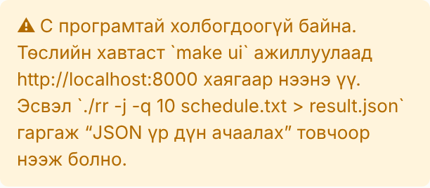

# БИЕ ДААЛТ 1 — ГАРЫН АВЛАГА

**ШИНЖЛЭХ УХААН ТЕХНОЛОГИЙН ИХ СУРГУУЛЬ**

**Мэдээлэл, холбооны технологийн сургууль**


**Хэрэглэгчийн болон Operational заавар (Manual)**

Үйлдлийн систем (F.CSM302) · 2026-2027 оны хичээлийн жилийн намар

| Талбар | Мэдээлэл |
|---|---|
| **Сэдэв** | CPU Scheduling |
| **Programming project** | Scheduling Algorithms |
| **UI дүрслэл** | Gantt chart |
| **Хуваарилалтын код** | 2-4-8 |
| **Хичээл заасан багш** | Г.Ганбат /F.CS10/ |
| **Бие даалтын ажлыг гүйцэтгэсэн** | B241940003 (Д.Хосбаяр), B241940141 (Н.Төрболд), B222270023 (М.Алтан-Од), B242270072 (Д.Анхбаяр) |

2026 он

---

## Гарчиг

- 1\. Хэрэглэгчийн заавар
   - 1.1. Програмын зорилго
   - 1.2. Дэмжих орчин
   - 1.3. Суулгах эсвэл нээх алхам
   - 1.4. Оролт ба тохиргоо
   - 1.5. Ажиллуулах, зогсоох, reset хийх
   - 1.6. Дүрслэлийн тэмдэг, өнгө, төлөв
   - 1.7. Жишээ
   - 1.8. Түгээмэл алдаа ба шийдэл
- 2\. Operational заавар
   - 2.1. Repository clone хийх
   - 2.2. OS, compiler/runtime, version
   - 2.3. Dependency суулгах
   - 2.4. Build ба Run команд
   - 2.5. Үндсэн тестийн өгөгдөл
   - 2.6. Нэмэлт boundary/error test
   - 2.7. Хүлээгдсэн үр дүн
   - 2.8. Known issues
- Ашигласан материал

## 1. Хэрэглэгчийн заавар

### 1.1. Програмын зорилго

CPU Scheduling Simulator нь task-уудын жагсаалтыг сурах бичгийн таван алгоритмаар (FCFS, SJF, Priority, Round-Robin, Priority + Round-Robin) хуваарилж, үр дүнг Gantt chart болон дундаж waiting, turnaround, response time-аар харуулна [1]. Хэрэглэгч task-ууд болон time quantum-ыг өөрчилж, алгоритмуудыг ижил нөхцөлд харьцуулж туршина. Програм нь терминалын хувилбар (`./fcfs`, `./sjf`, `./priority`, `./rr`, `./priority_rr`) болон browser-т ажилладаг interactive UI-аас бүрдэнэ. UI нь терминалын програмыг дотроо ажиллуулдаг тул хоёулаа ижил үр дүн өгнө.

### 1.2. Дэмжих орчин

| Бүрэлдэхүүн | Шаардлага |
|---|---|
| Үйлдлийн систем | Linux, macOS, эсвэл Windows 10/11 + WSL (Ubuntu) |
| Compiler | GCC эсвэл Clang (C11), GNU Make |
| Runtime | Python 3.8 ба түүнээс дээш (зөвхөн UI ба тестэд) |
| Browser | Chrome, Edge, Firefox, Safari-ийн сүүлийн хувилбар |

Гуравдагч талын сан суулгах шаардлагагүй. Windows дээр C програмыг WSL дотор build хийж ажиллуулна. Browser-ийг Windows дээрээ нээнэ.

### 1.3. Суулгах эсвэл нээх алхам

1. Төслийг татна: `git clone https://github.com/Ankhbayr33/F.CSM302-2-4-8.git`, дараа нь `cd F.CSM302-2-4-8`. Zip файлаар авсан бол задлаад тэр хавтас руу орно.
2. Програмуудыг build хийнэ: `make`. Хавтаст `fcfs`, `sjf`, `priority`, `rr`, `priority_rr` гэсэн 5 програм үүснэ.
3. UI-г асаана: `make ui`. Терминалд `Scheduler UI running at http://localhost:8000` гэж гарна.
4. Browser-т `localhost:8000` хаягийг нээнэ. Баруун дээд буланд **“C backend холбогдсон”** гэж гарвал бэлэн.

UI ажиллаж байх хугацаанд терминалын цонхыг хаахгүй. `index.html` файлыг шууд давхар дарж нээвэл C програмтай холбогдохгүй.

### 1.4. Оролт ба тохиргоо


*Зураг 1. UI-ийн бүрэлдэхүүн хэсгүүд (дугаарыг доорх хүснэгтээс харна)*

| № | Хэсэг | Тайлбар |
|---|---|---|
| 1 | Алгоритм | FCFS, SJF, Priority, RR, Priority + RR. Time quantum талбар зөвхөн RR, Priority-RR-д идэвхтэй |
| 2 | Task-ууд | Мөр бүрт `нэр, priority, burst[, arrival]` |
| 3 | Бэлэн жишээ | Номын жишээ, 8 task, ирэх хугацаатай, convoy effect, ижил priority, ганц task, алдаатай оролт |
| 4 | Ажиллуулах | Сонгосон алгоритмыг C програмаар ажиллуулна |
| 5 | Тоглуулагч | Gantt chart-ыг хугацааны дагуу тоглуулна |
| 6 | Gantt chart | CPU мөр ба task бүрийн мөр |
| 7 | Төлөв | t агшинд ажиллаж буй, хүлээж буй, ирээгүй, дууссан task |
| 8 | Дундаж үзүүлэлт | Avg waiting, turnaround, response time, CPU ашиглалт, context switch, throughput |
| 9 | Хүснэгт | Task бүрийн Start, Finish, Turnaround, Waiting, Response |
| 10 | Backend төлөв | C програмтай холбогдсон эсэх |

Task-ын мөрийн утгууд:

| Талбар | Утга | Жишээ |
|---|---|---|
| нэр | Үсэг, тоо, `_ - .`, 31 тэмдэгт хүртэл, давхардахгүй | `T1`, `P_2` |
| priority | 1–10, их тоо нь өндөр priority | `4` |
| burst | CPU-д ажиллах хугацаа, 1–1 000 000 | `20` |
| arrival | Ирэх хугацаа, 0–1 000 000. Заавал биш, анхдагч 0 | `5` |
| time quantum | RR-ийн нэг slice, 1–1 000 000, анхдагч 10 | `4` |

`#`-ээр эхэлсэн мөр тайлбар, хоосон мөрийг алгасна. Task-уудыг гараар бичихээс гадна **“Санамсаргүй task үүсгэх”** хэсгээр (1–50 task, max burst, max arrival) үүсгэх, **“.txt ачаалах”** товчоор файлаас уншуулах, **“schedule.txt татах”** товчоор хадгалах боломжтой.

### 1.5. Ажиллуулах, зогсоох, reset хийх

| Үйлдэл | Товч | Гарын товч |
|---|---|---|
| Сонгосон алгоритмаар ажиллуулах | ▶ Ажиллуулах | — |
| Таван алгоритмыг харьцуулах | Бүх алгоритмыг харьцуулах | — |
| Тоглуулах / түр зогсоох | ▶ / ⏸ | Space |
| Өмнөх / дараагийн үйл явдал | ◀ / ▶\| | ← / → |
| Эхлэл / төгсгөл | ⏮ / ⏭ | Home / End |
| Хүссэн агшин руу очих | Хугацааны slider | — |
| Тоглуулах хурд | Хурд: 5, 10, 25, 60 нэгж/сек | — |
| Анхны тохиргоонд буцах | Reset | — |
| CLI-ийн JSON үр дүнг нээх | JSON үр дүн ачаалах | — |

“Үйл явдал” гэдэг нь task CPU авсан, slice дууссан, task ирсэн эсвэл дууссан агшин юм. Reset нь үр дүнг арилгаж, алгоритмыг FCFS, quantum-ыг 10 болгоод сонгосон жишээний task-уудыг дахин ачаална. UI-г бүрэн зогсоохдоо терминал дээр `Ctrl + C` дарна.

Терминалаас шууд ажиллуулах:

```
./fcfs schedule.txt               # номын жишээ
./rr -q 4 tests/data/arrival.txt  # quantum = 4
./sjf -j schedule.txt > result.json
./rr -h                           # тусламж
```

### 1.6. Дүрслэлийн тэмдэг, өнгө, төлөв

| Тэмдэг | Утга |
|---|---|
| Нэртэй өнгөт блок | Task CPU дээр ажилласан хугацаа. Өргөн нь хугацаатай пропорционал |
| Ташуу зураастай өнгөт блок | 9 дэх болон түүнээс хойшхи task (өнгө давтагдах тул зураасаар ялгана) |
| Ташуу зураастай саарал `idle` | CPU хоосон, ирсэн task байхгүй |
| Тасархай хүрээ | Task ирсэн боловч ready queue-д хүлээж байна |
| ▼ | Task ирсэн агшин (arrival) |
| ✓ 45 | Task 45-д дууссан |
| Улаан босоо шугам `t=…` | Тоглуулагчийн одоогийн хугацаа |
| CPU мөрийн доорх тоо | Сегментийн хил (Gantt chart-ын цаг) |
| Хүснэгтийн саарал мөр / тод мөр | Дууссан task / одоо ажиллаж буй task |
| ★, ногоон багана | Харьцуулалтад хамгийн бага (сайн) утга |
| ● C backend холбогдсон / ● Backend алга | C програмтай холбогдсон эсэх |

Task бүр оролтын дарааллаараа тогтмол өнгөтэй. Блок бүр дээр task-ын нэр бичигддэг. Хэт нарийн блокт нэр багтахгүй бол хулганаа дээр нь аваачихад нэр, эхэлсэн, дууссан хугацаа нь гарч ирнэ.

### 1.7. Жишээ

**Жишээ 1. Номын жишээ, Round-Robin.** “Бэлэн жишээ” жагсаалтаас “Номын жишээ (5 task, P-29)”-г сонгоод Алгоритм = RR, Time quantum = 10 болгоно. “▶ Ажиллуулах” дарна.

Хүлээгдэх үр дүн:

- Gantt chart: T1 T2 T3 T4 T5 T1 T2 T3 T4 T2 T3, хугацаа 0–95.
- Дундаж waiting time 57, response time 20, context switch 10.

Терминал дээр `./rr schedule.txt` командаар ижил үр дүн гарна:

```
Running task = [T1] [4] [20] for 10 units.
Running task = [T2] [2] [25] for 10 units.
...
|  T1  |  T2  |  T3  |  T4  |  T5  |  T1  |  T2  |  T3  |  T4  |  T2  |  T3  |
0      10     20     30     40     50     60     70     80     85     90     95
```

**Жишээ 2. Ирэх хугацаа ба CPU idle.** “Ирэх хугацаатай + CPU idle” жишээг сонгоод RR, q = 4-өөр ажиллуулна. Тоглуулагчийг t = 13 дээр зогсооно (slider эсвэл ⏸).

Хүлээгдэх үр дүн:

- “Төлөв” хэсэгт P4 ажиллаж, P1 ба P3 хүлээж, P5 ирээгүй, P2 дууссан байна (Зураг 1).
- Төгсгөлд нь 26–40 хооронд `idle` блок гарч, CPU ашиглалт 66.67% болно.

**Жишээ 3. Convoy effect.** “Convoy effect (FCFS vs SJF)” жишээг сонгоод **“Бүх алгоритмыг харьцуулах”** дарна. Хуудасны доод талд таван алгоритмын харьцуулалт гарна. Дундаж waiting time нь FCFS-д 43.6, SJF-д 6.0 болж, SJF-ийн багана ★-аар тэмдэглэгдэнэ.

### 1.8. Түгээмэл алдаа ба шийдэл

| Мэдээлэл / шинж тэмдэг | Шалтгаан | Шийдэл |
|---|---|---|
| “Backend алга — JSON үр дүн ачаалж үзэх боломжтой” | UI-г файлаас шууд нээсэн эсвэл сервер асаагүй | `make ui` ажиллуулаад `localhost:8000`-оор нээнэ |
| “Build хийгдээгүй: …” | Програмууд compile хийгдээгүй | Терминал дээр `make` |
| `line 2: priority '11' must be an integer from 1 to 10` | Priority хүрээнээс гарсан | 1–10 болгоно |
| `CPU burst '0' must be a positive integer` | Burst 0 эсвэл сөрөг | Burst ≥ 1 |
| `expected 'name, priority, burst[, arrival]'` | Талбар дутуу эсвэл илүү | 3 эсвэл 4 талбартай болгоно |
| `duplicate task name 'T1'` | Нэр давхардсан | Өөр нэр өгнө |
| `invalid task name 'T 1'` | Нэрэнд хоосон зай, тусгай тэмдэгт байна | Үсэг, тоо, `_ - .` ашиглана |
| `Time quantum нь 1-ээс 1000000 хүртэлх бүхэл тоо байх ёстой` | Quantum буруу | Эерэг бүхэл тоо оруулна |
| `quantum too small: about … time slices` | Slice 200 000-аас олон болох гэж байна | Quantum-ыг ихэсгэнэ |
| `cannot listen on port 8000` | Порт өөр програмд ашиглагдаж байна | `python3 ui/server.py --port 8001` |
| `make: command not found` | Build хэрэгсэл суугаагүй | `sudo apt install -y build-essential python3` |



*Зураг 2. Сервергүй нээсэн үед гарах мэдээлэл*

Оролтын алдаа гарсан үед програм scheduling эхлүүлэхгүй, өмнөх chart-ыг арилгаж, алдааны мэдээллийг улаанаар харуулна.

## 2. Operational заавар

### 2.1. Repository clone хийх

```
git clone https://github.com/Ankhbayr33/F.CSM302-2-4-8.git
cd F.CSM302-2-4-8
```

Repository-ийн бүтэц: `src/` (C эх код), `ui/` (вэб UI ба сервер), `tests/` (тестийн өгөгдөл, скрипт), `docs/` (гарын авлага, зураг), `Makefile`, `schedule.txt` (номын жишээ), `README.md`, `Report.md`.

### 2.2. OS, compiler/runtime, version

| | Туршсан хувилбар |
|---|---|
| OS | Ubuntu 24.04 LTS (x86-64); Windows + WSL Ubuntu |
| C compiler | GCC 13.3.0, Clang 18.1.3 |
| Compiler тохиргоо | `-std=c11 -Wall -Wextra -pedantic -O2` (анхааруулгагүй) |
| Make | GNU Make |
| Python | 3.13 (3.8+ хангалттай) |
| Browser | Chromium (Playwright-аар автомат шалгасан) |

### 2.3. Dependency суулгах

| Орчин | Команд |
|---|---|
| Ubuntu / WSL | `sudo apt update && sudo apt install -y build-essential python3` |
| macOS | `xcode-select --install` (Command Line Tools-той хамт `python3` суудаг) |
| Windows | PowerShell-д `wsl --install`, дахин ачаалаад Ubuntu-д дээрх apt командыг ажиллуулна |

Python-ий нэмэлт сан (pip) шаардлагагүй. Зөвхөн standard library ашигладаг.

### 2.4. Build ба Run команд

| Команд | Үйлдэл |
|---|---|
| `make` | Таван програмыг build хийнэ (`build/` хавтаст object файл) |
| `make fcfs` | Зөвхөн нэгийг (`sjf`, `priority`, `rr`, `priority_rr`) |
| `./fcfs schedule.txt` | Ажиллуулах, номын формат |
| `./rr -q 4 schedule.txt` | Өөр quantum |
| `./sjf -j schedule.txt` | JSON гаралт |
| `make ui` | Build + UI сервер (http://localhost:8000) |
| `python3 ui/server.py --port 8001 --no-browser` | Өөр порт, browser автоматаар нээхгүй |
| `make test` | Бүх автомат тест |
| `make clean` | Build-ийн гаралтыг устгана |

### 2.5. Үндсэн тестийн өгөгдөл

| Файл | Агуулга |
|---|---|
| `schedule.txt`, `tests/data/book.txt` | Номын 5 task: T1 (4, 20), T2 (2, 25), T3 (3, 25), T4 (3, 15), T5 (10, 10) |
| `tests/data/eight.txt` | 8 task, бүгд 0-д ирнэ |
| `tests/data/arrival.txt` | 5 task, arrival 0–40, CPU idle үүсгэнэ |
| `tests/data/convoy.txt` | 50 нэгжийн нэг урт task, 3 нэгжийн дөрвөн богино task |
| `tests/data/same_priority.txt` | Ижил priority-тэй 3 task (Priority-RR) |
| `tests/data/single.txt` | Ганц task, priority 1, arrival 3 |
| `tests/data/whitespace.txt` | Таслалгүй формат, тайлбар мөр |

Хүлээгдсэн гаралт нь `tests/expected/<алгоритм>_<файл>_q<quantum>.txt` файлуудад байна (49 файл).

### 2.6. Нэмэлт boundary/error test

`tests/errors/` хавтаст 13 алдаатай оролт байна. Тэдгээр нь priority 0 ба 11, burst 0, −5, 2 000 000, arrival −1, дутуу ба илүү талбар, давхардсан нэр, хоосон файл, нэрэнд хоосон зай, тоо биш утга, хэт олон RR slice юм. Програм бүрд нь 1 кодоор гарч, мөрийн дугаартай мессеж өгөх ёстой.

Командын мөрийн 10 тест нь `-q 0`, `-q abc`, утгагүй `-q`, мэдэгдэхгүй сонголт `-x`, файлгүй, байхгүй файл, хоёр файл, `-h`, FCFS-д `-q` өгөхөд гарах анхааруулга, JSON гаралтын зөв эсэхийг шалгана.

`tests/reference_check.py` нь Python дээр бие даан бичсэн таван алгоритмтай санамсаргүй task set-үүд дээр харьцуулна. Тохиолдлын тоо, seed-ийг өөрчилж болно:

```
python3 tests/reference_check.py --cases 1000 --seed 7
```

### 2.7. Хүлээгдсэн үр дүн

`make test` командын төгсгөлд:

```
reference check: 1500/1500 runs match (300 random task sets x 5 algorithms)
  PASS  C schedulers match tests/reference_check.py

Passed: 73   Failed: 0
```

Номын жишээний (`schedule.txt`, q = 10) дундаж үр дүн:

| Алгоритм | Avg TAT | Avg WT | Avg RT |
|---|---|---|---|
| FCFS | 63.00 | 44.00 | 44.00 |
| SJF | 49.00 | 30.00 | 30.00 |
| Priority | 52.00 | 33.00 | 33.00 |
| RR | 76.00 | 57.00 | 20.00 |
| Priority-RR | 54.00 | 35.00 | 30.00 |

Алдаатай оролтын жишээ:

```
$ ./fcfs bad.txt
error: line 2: priority '11' must be an integer from 1 to 10
$ echo $?
1
```

### 2.8. Known issues

- Ажиллаж буй task-ыг slice дундуур нь preempt хийхгүй (номонд шаардаагүй). Preemptive SJF (SRTF), aging хэрэгжээгүй.
- Simulated хугацаа нь бүхэл тоо. Context switch-ийн зардлыг 0 гэж үзнэ.
- `__sync_fetch_and_add` нь зөвхөн GCC, Clang-д ажилладаг. MSVC дээр энгийн increment ашиглана.
- UI сервер зөвхөн `127.0.0.1`-д сонсдог тул өөр компьютерээс хандах боломжгүй.
- 1000-аас олон task, 1 000 000-аас их утга оруулах боломжгүй.
- WSL дотор `make ui` ажиллуулахад browser автоматаар нээгдэхгүй байж болно. Тэр үед Windows-ийн browser-т `localhost:8000` хаягийг гараар нээнэ.
- Windows-ийн `cmd`, PowerShell дээр шууд build хийгдэхгүй. WSL эсвэл MSYS2 ашиглана.

## Ашигласан материал

[1] A. Silberschatz, P. B. Galvin, G. Gagne. *Operating System Concepts*. 10th edition. Wiley, 2018. Chapter 5; Programming Projects P-29–P-31.

[2] F.CSM302. Бие даалт 1 гарын авлага (OS_BD1_Guide.pdf), 8-р хэсэг “Manual”.
