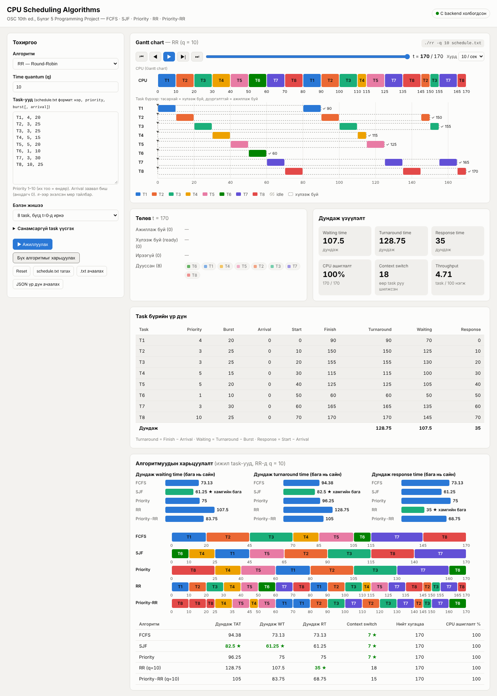

# F.CSM302 Үйлдлийн систем — Бие даалтын ажил
## Төсөл 8: Scheduling Algorithms (CPU Scheduling, Gantt chart)

**Оюутан:** Н. Төрболд (B241940141)
**Баг:** ........
**Огноо:** 2026 оны 10 сар 29

---

## 1. Удиртгал ба зорилго

Энэ төсөл нь *Operating System Concepts* (2018) номын 5-р бүлэг (CPU Scheduling)-ийн Programming Project-ийг хэрэгжүүлсэн болно. Зорилго нь task-уудын жагсаалтыг FCFS, SJF, Priority, Round-Robin (RR), Priority-RR алгоритмаар хуваарилж, үр дүнг Gantt chart-аар дүрслэн, waiting, turnaround, response time-аар харьцуулах явдал юм.

## 2. Онолын хураангуй

| Алгоритм | Зарчим |
|---|---|
| FCFS | Ирсэн дарааллаараа ажиллана. Энгийн боловч урт task түрүүлбэл богино task-ууд удаан хүлээнэ (convoy effect) |
| SJF | Хамгийн богино CPU burst-тэй task-ыг түрүүлж ажиллуулна. Дундаж waiting time хамгийн бага байх хандлагатай |
| Priority | Priority өндөртэй task түрүүлнэ (энд 1–10, их тоо = өндөр) |
| RR | Task бүр time quantum (q) хэмжээгээр ээлжлэн ажиллана. Response time сайн, гэхдээ context switch олон |
| Priority-RR | Priority-ээр бүлэглэж, ижил priority-той task-уудад RR хэрэглэнэ |

**Хэмжүүрүүд:**
- **Waiting time** — task ready дараалалд хүлээсэн нийт хугацаа
- **Turnaround time** — ирснээс дуустал нийт хугацаа
- **Response time** — ирснээс анх удаа CPU авах хүртэлх хугацаа

## 3. Хэрэгжүүлэлт

- **Хэл:** C (C11). Алгоритм бүр тусдаа програм: `fcfs`, `sjf`, `priority`, `rr`, `priority_rr` (`src/` хавтас).
- **Build:** `Makefile` (`make`, `make rr`, `make clean`). Гадны сан ашиглаагүй.
- **Оролт:** `нэр, priority, burst[, arrival]` форматтай мөр бүхий текст файл (`schedule.txt`). Priority 1–10, burst ≥ 1, arrival ≥ 0.
- **Гаралт:** Gantt chart болон хэмжүүрүүдийг текстээр, мөн `-j` сонголтоор JSON (`result.json`) хэлбэрээр гаргана.
- **UI:** `ui/` хавтас дахь вэб интерфейс (`make ui`, `http://localhost:8000`). C програмыг дуудаж Gantt chart-ыг тоглуулж, 5 алгоритмыг харьцуулах bar chart гаргана.

## 4. UI-ийн танилцуулга

Gantt chart дээр task бүр өнгөөр ялгагдана, `idle` үе саарал зураастай, ирсэн агшин ▼, дууссан агшин ✓ тэмдэгтэй харагдана. Тоглуулагч нь эхлэл, өмнөх/дараагийн үйл явдал, slider, хурд тохируулах боломжтой.

<!-- Screenshot-оо энд оруулна. Жишээ: -->

## 5. Тест ба үр дүн

### 5.1 Номын жишээ (5 task)

| Алгоритм | Дундаж waiting time |
|---|---|
| FCFS | 44 |
| SJF | 30 |
| Priority | 33 |
| RR (q = 10) | 57 |
| Priority-RR | 35 |

RR-ийн Gantt дараалал: T1 T2 T3 T4 T5 T1 T2 T3 T4 T2 T3 (0…95). Дундаж waiting 57, response 20.

### 5.2 Convoy effect

Урт task эхэлж ажилласан тохиолдолд FCFS-ийн дундаж waiting 43.6 байхад SJF-д 6 болж буурсан. Энэ нь FCFS-ийн сул талыг харуулна.

### 5.3 Idle үе

Arrival хугацаатай жишээнд (RR, q = 4) 26–40 хооронд CPU idle болсон.

### 5.4 Автомат тест

- `tests/data/` — 7 төрлийн оролтын өгөгдөл
- `tests/errors/` — boundary болон алдаатай оролтууд (priority 0/11, burst 0, давхардсан нэр, хоосон файл г.м.)
- `make test` үр дүн: **Passed: 73, Failed: 0**
- `tests/reference_check.py` — 1000 санамсаргүй тохиолдлыг жишиг хэрэгжүүлэлттэй харьцуулсан

## 6. Харьцуулсан дүн шинжилгээ

- **SJF** нь дундаж waiting time-ийн хувьд хамгийн сайн (30).
- **RR** нь waiting time өндөр (57) боловч бүх task-д CPU-г шударгаар хуваарилж, response time сайн байлгана.
- **Priority** нь чухал task-уудыг түрүүлнэ, гэхдээ бага priority-тай task-ууд хүлээх (starvation) эрсдэлтэй.
- **Priority-RR** нь priority болон шударга байдлыг тэнцвэржүүлнэ.

## 7. Хязгаарлалт

- Ажиллаж буй task-ыг slice дундуур preempt хийхгүй; preemptive SJF (SRTF) хэрэгжээгүй.
- Хугацаа бүхэл тоо, context switch-ийн зардал 0 гэж үзсэн.
- `__sync_fetch_and_add` нь GCC/Clang-д л ажиллана.
- UI сервер зөвхөн `127.0.0.1` дээр ажиллана.
- 1000-аас олон task, 1 000 000-аас их утга дэмжихгүй.

## 8. Дүгнэлт

Төслөөр CPU scheduling-ийн таван алгоритмыг C хэлээр хэрэгжүүлж, вэб UI дээр Gantt chart-аар дүрслэн харьцуулсан. Туршилтаар алгоритм бүр өөр өөр давуу, сул талтай болохыг баталсан бөгөөд автомат тестүүд бүгд амжилттай давсан. Ажлын явцад алгоритмуудын ялгаа, convoy effect, starvation зэрэг ойлголтыг практикаар гүнзгий ойлгосон.

## 9. Ашигласан материал

- Silberschatz, Galvin, Gagne. *Operating System Concepts* (2018), Chapter 5 — Programming Projects.
- Төслийн `README.md`, `docs/MANUAL.md`.